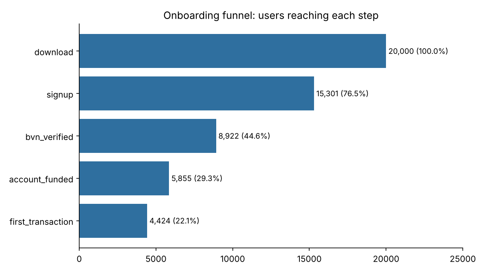
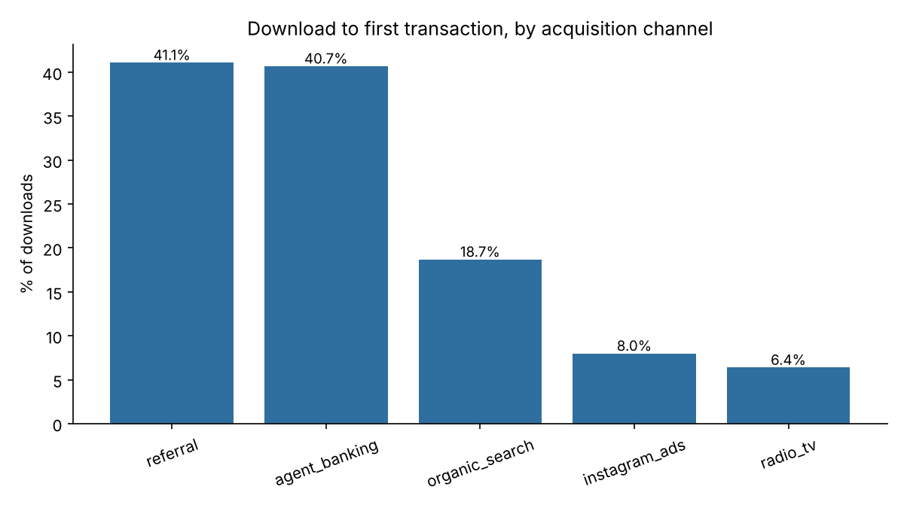

# Onboarding Funnel Analysis for a Digital Banking App

**Question:** Of everyone who downloads a mobile banking app, how many become active customers, where do we lose the rest, and which acquisition channels bring the best users?

> All data is **synthetic** (20,000 simulated users). The drop-off patterns are modelled on typical Nigerian digital-banking onboarding, where identity verification (BVN) is the main friction point. No real customer data is used.

## The funnel

`download -> signup -> BVN verified -> account funded -> first transaction`

| Step | Users | % of downloads | Step conversion |
|---|---|---|---|
| Download | 20,000 | 100% | - |
| Signup | 15,301 | 76.5% | 76.5% |
| BVN verified | 8,922 | 44.6% | 58.3% |
| Account funded | 5,855 | 29.3% | 65.6% |
| First transaction | 4,424 | 22.1% | 75.6% |



## Findings

1. **BVN verification is the biggest leak.** 41.7% of users who sign up never complete it. Fixing this one step moves the whole funnel more than any other change.
2. **Channel quality differs enormously.** Referral (41.1%) and agent banking (40.7%) turn downloads into first transactions at 5-6x the rate of Instagram ads (8.0%) and radio/TV (6.4%).
3. **Paid channels fail at verification, not at signup.** Instagram and radio/TV users sign up reasonably well but only about 40% of them pass BVN verification, compared with about 70-80% for referral and agent users. This suggests paid audiences are less committed or less prepared (no BVN to hand), not that the ad creative is bad.



## What I would recommend (product/growth view)

- **Reduce BVN friction:** let users save progress and return, explain *why* BVN is needed on the screen, and send a reminder 24 hours after an abandoned verification.
- **Shift budget toward referral and agent banking**, and test a referral incentive that pays out only after the *first transaction*, not at signup.
- **Judge paid channels on cost per activated customer, not cost per install.** On installs alone, Instagram looks like the biggest channel; on activation it is one of the weakest.

## How to run

```bash
pip install pandas matplotlib
python src/generate_data.py   # creates data/onboarding_events.csv
python src/analyze.py         # prints tables, saves charts and CSVs to outputs/
```

## What this project demonstrates

Funnel analysis, conversion metrics, channel quality vs. volume, and turning numbers into a recommendation. Built with Python (pandas, matplotlib).
